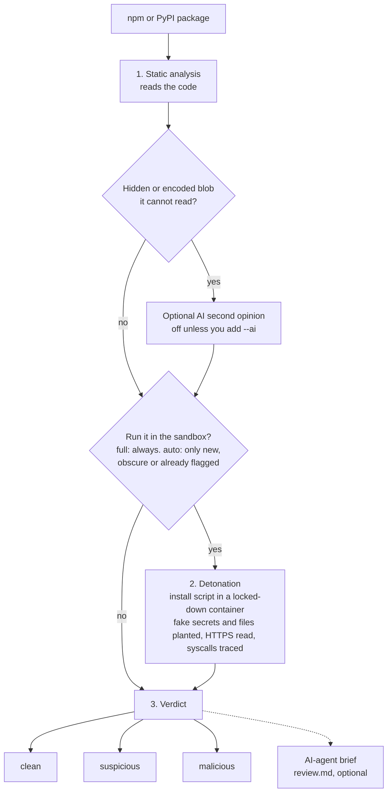

<p align="center">
  <a href="assets/logo.png">
    
  </a>
</p>

> Traditional SCA asks: "Is this dependency already known to be vulnerable or malicious?"
> MalwHunter asks: "What does this dependency actually do before we trust it?"

[](https://github.com/ImGauravbhosale/Malwhunter/actions/workflows/ci.yml)
[](https://github.com/ImGauravbhosale/Malwhunter/actions/workflows/security-scan.yml)
[](https://github.com/ImGauravbhosale/Malwhunter/actions/workflows/lint.yml)
[](https://scorecard.dev/viewer/?uri=github.com/ImGauravbhosale/Malwhunter)
[](pyproject.toml)
[](LICENSE)

**MalwHunter** hunts for malware deliberately hidden inside your
dependencies — the class of attack behind incidents like event-stream,
ua-parser-js, coa/rc, colors.js, and node-ipc.

Docs: https://imgauravbhosale.github.io/Malwhunter/

## What it does

MalwHunter checks the packages your project depends on **before you trust them**.
For every npm or PyPI package it can:

1. **Read the code** for the tricks malware uses: hidden commands, encoded payloads, stolen secrets.
2. **Run the package's install script in a sandbox** and watch what it really does.
3. **Optionally**, hand the findings to an AI agent for a second opinion you can check yourself. (AI is a side dish: nothing in MalwHunter needs it.)

Each package ends up as **clean**, **suspicious** or **malicious**, with the exact
file, line or network connection as proof.

## Quick start

```bash
git clone https://github.com/ImGauravbhosale/Malwhunter.git
cd Malwhunter
uv sync

uv run malwhunter                                          # the logo and every command
uv run malwhunter inspect left-pad@1.3.0 --mode static     # check one package
uv run malwhunter scan . --mode static                     # check a whole project
```

Needs Python 3.11 or newer. Docker (version 28 or newer) is only needed for the sandbox.
Run `malwhunter` with no arguments any time to see these commands again.

## Choose how to scan

| You want | Add this | Docker? |
|---|---|---|
| **Static analysis only**: read the code, run nothing | `--mode static` | no |
| **Detonation only**: run the install script in a sandbox, skip the code rules | `--mode detonate-only` | yes |
| **Both**, on every package | `--mode full` | yes |
| **Smart default**: static analysis, sandbox only for new, obscure or already-flagged packages | `--mode auto` | yes, when needed |
| **Optional extras (off unless you ask)**: a brief to paste into any AI agent, or an AI second opinion on encoded strings | `--format agent-prompt --out review.md` or `--ai` | no |

The older `--no-detonate` and `--always-detonate` flags still work (they mean `static` and `full`).
With `detonate-only`, a package that was not run in the sandbox (no install script, or no Docker)
is reported as **unscanned**, never as clean.

## Run it on your machine

```bash
malwhunter scan . --mode static                    # read the code only
malwhunter scan . --mode detonate-only             # sandbox only
malwhunter scan . --mode full                      # both, all in one
malwhunter inspect left-pad@1.3.0 --mode full      # one npm package
malwhunter inspect pypi:requests==2.31.0 --mode static   # one PyPI package
malwhunter scan . --mode static --format agent-prompt --out review.md   # brief for an AI agent
```

`scan .` reads `package-lock.json` for npm, and `uv.lock`, `poetry.lock`, `Pipfile.lock`
or `requirements.txt` for Python. A package that is not pinned to an exact version cannot be
checked, so it is reported as **unscanned** instead of being skipped.

## Choose the output

Results print in the terminal by default for `inspect`; `scan` writes JSON by default.
Pick another format with `--format`, and save to a file with `--out`:

| `--format` | For | Notes |
|---|---|---|
| `terminal` | people at a console | colored, with a detonation section for every package that ran |
| `json` | scripts and other tools | full detail, including `detonation_summary` |
| `markdown` | pull-request comments, wikis | text from the package is escaped |
| `csv` | spreadsheets | one row per finding; packages with none still get a row; cells that look like formulas are neutralised |
| `sarif` | GitHub code scanning, VS Code | SARIF 2.1.0; unscanned packages appear as notes, `.MHignore` rules as suppressions |
| `agent-prompt` | a second opinion (optional) | a review brief to paste into any AI agent or hand to a colleague |

```bash
malwhunter scan . --mode static --format csv --out findings.csv
malwhunter scan . --mode full --format sarif --out malwhunter.sarif
```

When you use `--out` with any format, the terminal view is still printed too.

## Run it in CI/CD

```bash
# Full scan: every dependency, nothing remembered between runs
malwhunter scan . --mode full --fail-on malicious --jobs 4 \
  --format json --out malwhunter-report.json

# Delta scan: only packages that are new or changed since the last run.
# Keep the .malwhunter-cache folder between runs (actions/cache or your CI's equivalent).
malwhunter scan . --mode auto --fail-on malicious --jobs 4 \
  --cache-dir .malwhunter-cache --format json --out malwhunter-report.json
```

No AI flag is needed in CI (the AI second opinion is off unless you add `--ai`). A cached result is never trusted blindly:
it is dropped after 7 days, and whenever MalwHunter's own rules change.

It also ships as a GitHub Action ([`action.yml`](action.yml)), with no install step:

```yaml
- uses: ImGauravbhosale/Malwhunter@v0.2.0
  with:
    fail-on: malicious   # malicious | suspicious | none
    # detonate: smart    # smart (default) | always | never
    # format: json       # json | markdown | terminal | csv | sarif
    # ai: "false"        # optional, off by default
```

To see findings in the **Security** tab of your repository, write SARIF and upload it
(the job needs `security-events: write`):

```yaml
- id: malwhunter
  uses: ImGauravbhosale/Malwhunter@v0.2.0
  with:
    format: sarif
- uses: github/codeql-action/upload-sarif@v3
  if: always()   # upload even when MalwHunter fails the build
  with:
    sarif_file: ${{ steps.malwhunter.outputs.report-path }}
```

GitHub-hosted runners already have Docker, so the sandbox works with no extra setup
(the runner image needs Docker 28 or newer).

## How it works



**1. Static analysis.** MalwHunter unpacks the package and reads it without running anything.
JavaScript is parsed into a syntax tree, so it knows whether `exec` really is `child_process`'s and
catches tricks like `require('child' + '_process')`. Python is read the same way, and it matters
*where* the code runs: a shell command is normal in a library but a red flag in `setup.py`.
When it finds something it cannot read, such as an encoded blob, an optional AI second opinion
takes a look.

**2. Detonation.** The package's install script runs in a throwaway Docker container that has
no route to the internet or to your machine. Its traffic goes through a recording proxy that
reads HTTPS too, and the script is handed **fake secrets** (tripwires): environment variables
(`NPM_TOKEN`, `AWS_SECRET_ACCESS_KEY`, ...) and fake credential files (`~/.ssh/id_rsa`,
`~/.aws/credentials`, `~/.npmrc`, `~/.pypirc`). If a fake secret ever
leaves the container, even re-encoded, that is proof of theft. The run is also traced, so
reading `~/.ssh`, writing to `.bashrc`, or opening a raw network connection shows up with the
exact path.

**3. Verdict.** The rules are fixed and simple (see below). Every finding carries its evidence:
no evidence, no verdict.

## What it catches

| Attack | How it shows up |
|---|---|
| Install script that downloads and runs code (`curl ... \| sh`) | static finding, and the connection in the sandbox |
| Stolen secrets sent out | a fake secret leaves the sandbox, over HTTP or HTTPS |
| Stolen credential files (SSH key, AWS, npm, PyPI tokens) | the contents of a fake `~/.ssh/id_rsa`, `~/.aws/credentials`, `~/.npmrc` or `~/.pypirc` leave the sandbox |
| Hidden code (`eval`, base64 payloads, a module name built from pieces) | static finding |
| Reading SSH keys, cloud credentials, wallets; writing to `.bashrc`, cron, `authorized_keys` | seen in the sandbox trace |
| Connections that skip the proxy | seen in the sandbox trace |
| Look-alike names (`lodahs`, `reqeusts`) | static finding |
| A package name that does not exist (an AI-invented dependency) | flagged as claimable |
| A version npm itself took down as malware | reported as malicious |

## Reading the results

| Verdict | Meaning |
|---|---|
| **malicious** | A fake secret left the sandbox, **or** a strong code finding was backed by something seen in the sandbox, **or** two AI passes agreed |
| **suspicious** | Something worth a look, but one source only. It never fails a build by default |
| **clean** | Nothing found |
| **unscanned** | MalwHunter could not analyze it (download failed, no exact version, sandbox unavailable). Never counted as clean |

Exit code: `0` nothing found, `1` a package reached your `--fail-on` level (default `malicious`),
`2` some package could not be scanned, so the result is incomplete.

## When does `auto` mode use the sandbox?

The sandbox costs a few seconds per package, so by default it only runs when a package is worth it:

- the code scan already found something serious, or
- it was published in the last 30 days, or
- it has fewer than 1,000 downloads a month, or
- the popularity lookup failed (unknown is treated as not safe to skip).

Otherwise it is skipped, and the report says why. Change the limits with
`--detonate-age-threshold` and `--detonate-downloads-threshold`.

## Reviewed a finding and it's a false positive? `.MHignore` it

`--fail-on` is all-or-nothing across the whole scan, so a single
reviewed false positive shouldn't force you to turn off build-breaking
entirely. Drop a `.MHignore` file in the scanned directory — modeled on
Snyk's `.snyk` ignore policy, every rule requires a `reason` (no silent
suppression) and an optional `expires` date, after which it stops
applying on its own instead of being forgotten forever:

```json
[
  {
    "package": "left-pad",
    "version": "1.3.0",
    "reason": "Reviewed 2026-10-04 — bulk-env-enumeration signal is a false positive, confirmed benign by reading source",
    "expires": "2027-01-01"
  }
]
```

Omit `version` to match the package at any version. Ignored packages
are excluded from the `--fail-on` gate but still show up in the report
under their own `IGNORED` section with the reason attached — nothing
disappears silently. Stale rules (never matched a scanned package) and
expired rules are both flagged as warnings on stderr so they don't rot
unnoticed.

## Limits

MalwHunter is a heuristic tool, not a guarantee. Know what it cannot see:

- It checks install-time and import-time behavior, not what a package does later when you use it.
- The sandbox watches for 30 seconds (120 for Python installs). A script that waits longer is not seen.
- HTTPS is read through a certificate made for each run. A program that pins certificates fails
  its handshake and shows up only as a connection attempt.
- The syscall trace runs as the package's own user, so it is best-effort. A script that deletes
  its trace is itself reported, and a host that blocks tracing is reported as unavailable, never as clean.
- Only the four fake credential files and four environment variables are planted. A stealer that looks for other things (browser or wallet data) is seen in the trace when it opens them, but cannot leak a matching fake value.
- Static rules can be wrong. Use `.MHignore` for a reviewed false positive.
- npm needs `package-lock.json` (v2 or v3). For PyPI, only one wheel per release is scanned.

## Status

Early, under active development. Built and tested end to end (508+ automated tests, including
real Docker sandbox runs): npm and PyPI intake with integrity checks, syntax-tree static analysis,
the sandbox with HTTPS inspection, tripwire secrets and files, syscall tracing, delta scans, the
GitHub Action, and json / markdown / csv / sarif output.

**Not built yet:** other ecosystems, a DNS log inside the sandbox, scanning code that only runs when
a package is *used* (not installed or imported), comparison with a package's earlier versions, and
published benchmark numbers.


## Contributing

Issues and PRs welcome — see [CONTRIBUTING.md](CONTRIBUTING.md) for dev
setup and PR expectations, and the docs site for the full architecture
writeup before proposing changes to the Dossier model or the Recon/
static analysis and detonation passes. This project follows the
[Code of Conduct](CODE_OF_CONDUCT.md). Found a security issue? See
[SECURITY.md](SECURITY.md) rather than opening a public issue.

## License

[MIT](LICENSE)
