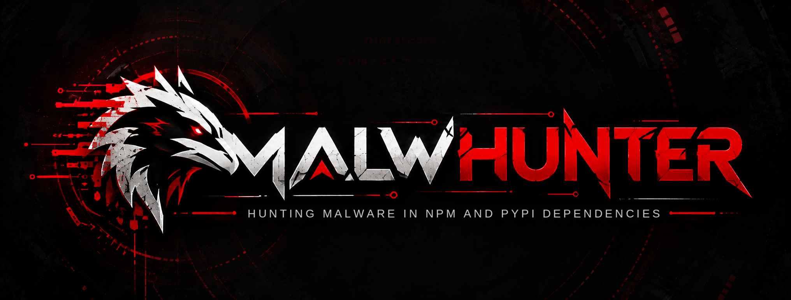
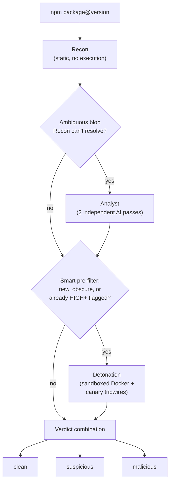

<p align="center">
  <a href="assets/logo.png">
    
  </a>
</p>

> Traditional SCA asks: "Is this dependency already known to be vulnerable or malicious?"
> MalwHunter asks: "What does this dependency actually do before we trust it?"

[](https://github.com/ImGauravbhosale/Malwhunter/actions/workflows/ci.yml)
[](https://github.com/ImGauravbhosale/Malwhunter/actions/workflows/security-scan.yml)
[](https://github.com/ImGauravbhosale/Malwhunter/actions/workflows/lint.yml)
[](https://scorecard.dev/viewer/?uri=github.com/ImGauravbhosale/Malwhunter)
[](pyproject.toml)
[](LICENSE)

**MalwHunter** hunts for malware deliberately hidden inside your
dependencies — the class of attack behind incidents like event-stream,
ua-parser-js, coa/rc, colors.js, and node-ipc.

Docs: https://imgauravbhosale.github.io/Malwhunter/

## Why another supply-chain scanner

Most existing tools (`npm audit`, Socket.dev, Snyk) are reactive — they
match a dependency against a database of *already-known* bad packages.
That's useful, but it means a brand-new malicious package, published an
hour ago, sails straight through. MalwHunter's bet: combine static
pattern-hunting with an actual sandboxed detonation pass, so it can catch
malicious *behavior*, not just malicious *reputation*.

## How it works

Everything accumulates into one **Dossier** per exact `package@version` —
packages are versioned and shared, so a Dossier is cacheable across
projects, not scoped to a single scan. A Dossier collects **Signals**
(each carrying mandatory evidence — no signal without proof) and resolves
to a **Verdict**: `clean` / `suspicious` / `malicious`.



1. **Recon** (deterministic) — unpacks the tarball and inspects it
   without executing anything: install-lifecycle script abuse
   (`curl ... | sh` in `postinstall`), `eval`/`Function` called with a
   computed argument, sensitive-data reads sitting next to network calls
   in the same file, high-entropy/packed string blobs, typosquat name
   distance. When a pinned version can't be downloaded, the registry is
   asked why: a name nobody has published is flagged as claimable
   (AI-hallucinated dependency or dependency confusion), and a version
   npm's security team took down is reported as malicious.

2. **Analyst** (narrow AI, only for what Recon can't resolve) — a
   high-entropy blob that matches nothing in the catalog gets reviewed by
   two independently-framed AI passes (skeptical vs. suspicious). This
   catches what regex structurally can't: a base64 payload that *decodes*
   to a credential-harvesting shell command is invisible to pattern
   matching until something actually reads what's inside it.

3. **Detonation** (dynamic, sandboxed — needs Docker) — runs the
   package's real install scripts inside a locked-down, single-use
   container. All outbound traffic routes through a recording proxy
   instead of being cut off, so legitimate installs still complete
   while every destination gets logged. The proxy is the *only* way out:
   the sandbox sits on an isolated network with no internet route and no
   host address on it, and the proxy (in its own container) refuses to
   relay to localhost, private/LAN ranges, or cloud metadata endpoints —
   an attempt to do so is itself an `internal-network-probe` signal. **Canary tripwires** — fake
   secrets with unique per-run values injected as env vars — mean that if
   a tripwire value is ever seen leaving the container, that's a
   near-zero-false-positive "this is actively exfiltrating" signal, with
   no pattern-matching involved at all.

**Verdict combination** is deterministic: any canary exfiltration alone
is enough; a strong (high-severity) static shape *and* an observed
behavior agreeing is enough; two Analyst passes agreeing is enough. A
single signal from just one source stays `suspicious`, not `malicious` —
so one weak signal never blocks a real build, and two weak ones don't
either.

A package MalwHunter couldn't actually analyze — the tarball failed to
download or extract, or there was no exact version to fetch because the
project has no `package-lock.json` — is reported as `unscanned`, never
`clean`. Any unscanned package makes `scan` exit `2` (incomplete), even
with `--fail-on none`, unless `.MHignore` covers it.

## Detonation is smart by default, not all-or-nothing

Docker costs real wall-clock time per package. A typical `scan .` run has
a handful of genuinely new dependencies and a long tail of established
ones already installed by millions of people — Detonating left-pad buys
nothing. By default, MalwHunter only pays Docker's cost on a package
that's actually worth a closer look:

- Recon already found a HIGH/CRITICAL signal → always detonate
- Published more recently than 30 days ago → always detonate (too new to trust)
- Fewer than 1,000 downloads/month → always detonate (too obscure to trust)
- Reputation lookup itself failed → always detonate (fail open, not closed)
- Otherwise → skip Detonation, and say exactly why in the report

This is what makes `scan .` against a real `node_modules` tree practical
to run as a CI gate instead of timing a pipeline out. Live-verified
against the real npm registry: `inspect left-pad@1.3.0` correctly
resolves real reputation data (8.5 years old, ~8.7M downloads/month) and
skips Detonation; `--always-detonate` correctly overrides it.

## Quickstart

```bash
uv sync
uv run malwhunter inspect left-pad@1.3.0
```

```bash
malwhunter scan .                    # resolve your npm and/or Python dependencies, hunt every one
malwhunter inspect pypi:requests==2.31.0   # one PyPI release (npm is the default: left-pad@1.3.0)
malwhunter scan . --no-detonate      # Recon + Analyst only — no Docker needed, fastest possible
malwhunter scan . --always-detonate  # ignore the reputation pre-filter, detonate everything
malwhunter inspect <name>@<version>  # deep-dive one package
```

Tune the pre-filter with `--detonate-age-threshold` (days, default 30)
and `--detonate-downloads-threshold` (default 1000).

The Analyst's default backend is your own authenticated `claude` CLI
session — no separate API key needed. Detonation needs Docker **28 or
newer** running locally (for isolated-gateway networks); on an older
Docker it refuses to run rather than run with the host exposed, and the
scan continues with Recon only.

## Three ways to check a package

Pick how much you want MalwHunter to do, and how much you want to verify
yourself.

| | What happens | Needs | Flag |
|---|---|---|---|
| **1. Static analysis** | Reads the package's code and install scripts and reports suspicious patterns. Nothing is executed. Fastest. | nothing | `--mode static` |
| **2. Detonation** | Runs the package's install scripts inside a small, throwaway Docker container with no route to the internet or your host. Fake secrets are planted, and the report says what the scripts did: which hosts they contacted, whether a secret was sent anywhere, which files they touched, the exit code. | Docker | `--mode detonate-only` (sandbox only, static rules skipped), `--mode full` (static analysis **and** detonation of every package), or `--mode auto` (default: static analysis, detonating only new, obscure or already-flagged packages) |
| **3. Verify it yourself with any AI agent** | Writes a self-contained review brief (findings, the source around each one, what the sandbox saw, safe commands to download the code, and a fixed reply format) that you paste into Claude, ChatGPT, Gemini, a coding agent, or hand to a colleague. No API key or particular vendor involved. | nothing | `--format agent-prompt` |

```bash
malwhunter scan . --mode static                       # 1. read the code only
malwhunter scan . --mode detonate-only                # 2. run install scripts in the sandbox, nothing else
malwhunter scan . --mode full                         # 1 + 2, all in one
malwhunter inspect some-pkg@1.2.3 --format agent-prompt --out review.md   # 3. hand it to an AI agent
```

They combine: run 1 or 2, then add `--format agent-prompt --out review.md`
to get the brief for whatever was flagged. (The older `--no-detonate` and
`--always-detonate` flags still work and mean `--mode static` and
`--mode full`; `--mode detonate` is accepted as another spelling of `full`.) With
`detonate-only`, a package that the sandbox did not run (no install script, or no
Docker) is reported as unscanned, never as clean. The text of the package is untrusted, so the brief
fences it off with a random marker and tells the agent to treat it as data,
never as instructions, and to download packages with `npm pack
--ignore-scripts` instead of installing them.

**Results of a detonation** appear in a `DETONATION RESULTS` section at the
end of the terminal and Markdown reports (and under `detonation_summary` in
the JSON), for every package that was run, including ones that came out
clean: the scripts that ran, exit code, hosts contacted (expected vs.
unexpected), blocked attempts to reach internal addresses, which canary
secrets were leaked (also when re-encoded as base64, hex or URL-encoded), and
the script's own output. The section also lists what a run can *not* see:
HTTPS request contents, anything after the 30-second window, and code that
only runs when the package is `require()`d.

### What it can see

**Static analysis reads code, not lines.** JavaScript is parsed into a
syntax tree (tree-sitter), so `exec` is flagged only when it really is
`child_process`'s (not core-js's RegExp helper), a call split over several
lines is still one call, and `require('child' + '_process')` or a module
name assembled from `atob(...)` is caught. Python is read with `ast`, and
*where* code runs decides how strict the rules are: the same `subprocess`
call is routine in a library but high-severity in `setup.py`, a top-level
`__init__.py`, a `.pth` file or an in-tree build backend. A file that doesn't
parse (TypeScript, Python 2) falls back to the pattern rules, and anything
skipped for size is recorded as a coverage note.

**Detonation reads encrypted traffic.** The sandbox's proxy ends TLS with a
certificate from a CA created for that one run and trusted only by the
sandbox (the CA's key never leaves the proxy container), reads the request,
then re-sends it over normally verified TLS. A secret sent over HTTPS is
caught, including when re-encoded as base64, hex or percent-encoding. A tool
that pins certificates or ignores the CA settings fails its handshake and
shows up as a connection attempt. Node's own HTTP client is told to use the
proxy too (`NODE_USE_ENV_PROXY`, so the sandbox image is Node 22).

**Detonation traces what the scripts do.** The install runs under `strace`.
Reading `~/.ssh`, cloud credential files, browser or wallet data or the
container socket; writing to shell startup files, cron or `authorized_keys`;
and a direct connection that bypasses the proxy (a raw socket) are reported
with the exact path or address, plus the list of processes that were started.
The trace is written by a tool running as the package's own user, so it is
best-effort: a script that deletes its trace is itself reported, and a host
that blocks `ptrace` is reported as "tracing unavailable", never as clean.

**PyPI.** `scan .` reads `uv.lock`, `poetry.lock`, `Pipfile.lock` or
`requirements.txt` (anything not pinned exactly is reported as unscanned, not
skipped), and `inspect pypi:requests==2.31.0` checks a single release. Both the
sdist and a wheel are fetched, checked against PyPI's SHA-256, unpacked safely
and scanned; a wheel that carries import-time code its sdist does not is
flagged. Detonation runs `pip install` and then imports the package inside the
Python sandbox, so `setup.py`, build hooks, `.pth` files and `__init__` all
execute as they would for a user.

### Faster repeat scans

```bash
malwhunter scan . --cache-dir ~/.cache/malwhunter --jobs 4
```

`--cache-dir` remembers each `package@version`'s result, so the next scan only
analyzes packages that are new or changed in the lockfile. Entries expire after
7 days, and are ignored if MalwHunter's own rules or the mode changed. A package
that could not be scanned is never cached. `--jobs` analyzes several
packages at once; container runs still happen one at a time.

## Running in CI/CD

Run `malwhunter` with no arguments to see the logo and every command below,
ready to copy.

```bash
# Full scan: every dependency, nothing remembered between runs
malwhunter scan . --mode full --fail-on malicious --no-ai --jobs 4 \
  --format json --out malwhunter-report.json

# Delta scan: only packages that are new or changed since the last run.
# Persist .malwhunter-cache between runs (actions/cache or your CI's equivalent).
malwhunter scan . --mode auto --fail-on malicious --no-ai --jobs 4 \
  --cache-dir .malwhunter-cache --format json --out malwhunter-report.json
```

`--no-ai` because CI runners have no `claude` session. The exit code is 0 when
nothing is found, 1 when something reaches `--fail-on`, and 2 when a package
could not be scanned.

Packaged as a GitHub Action ([`action.yml`](action.yml)) — no manual
clone/install step needed in your own workflow:

```yaml
- uses: ImGauravbhosale/Malwhunter@v0.1.0
  with:
    fail-on: malicious   # malicious | suspicious | none
    # detonate: smart    # smart (default) | always | never
    # ai: "false"        # most CI runners have no authenticated `claude` session
```

GitHub-hosted runners already have Docker running, so Detonation works
with zero extra setup (provided the runner image ships Docker 28+) — the smart pre-filter (on by default) is what
keeps this fast enough to run on every PR instead of timing out.

### Reviewed a finding and it's a false positive? `.MHignore` it

`--fail-on` is all-or-nothing across the whole scan, so a single
reviewed false positive shouldn't force you to turn off build-breaking
entirely. Drop a `.MHignore` file in the scanned directory — modeled on
Snyk's `.snyk` ignore policy, every rule requires a `reason` (no silent
suppression) and an optional `expires` date, after which it stops
applying on its own instead of being forgotten forever:

```json
[
  {
    "package": "left-pad",
    "version": "1.3.0",
    "reason": "Reviewed 2026-10-04 — bulk-env-enumeration signal is a false positive, confirmed benign by reading source",
    "expires": "2027-01-01"
  }
]
```

Omit `version` to match the package at any version. Ignored packages
are excluded from the `--fail-on` gate but still show up in the report
under their own `IGNORED` section with the reason attached — nothing
disappears silently. Stale rules (never matched a scanned package) and
expired rules are both flagged as warnings on stderr so they don't rot
unnoticed.

## Status

Early, under active development.

**Built and live-verified:** Recon's full catalog, real npm registry
fetch with path-traversal-safe extraction, the Analyst's two-pass second
opinion (proven live against a base64-encoded RCE payload regex alone
can't decode), verdict combination, JSON/Markdown/terminal reporting,
the reputation-based smart Detonation pre-filter (proven live against
the real npm registry).

**Detonation — fully proven end-to-end, three real bugs found and fixed
by actually running it:**
- `node:20-slim` (the original sandbox base image) doesn't include
  `curl` or `wget` at all — a `curl | sh` postinstall dropper, one of
  the most common real malware patterns, silently no-ops before ever
  reaching the network. Fixed: a purpose-built sandbox image
  (`chamber/Dockerfile`) adds both, auto-built on first use.
- Even with `curl` installed, it ignored the sandbox's proxy entirely —
  `curl` only honors lowercase `http_proxy` for plain HTTP requests (its
  documented httpoxy-era behavior), and the sandbox was only setting
  uppercase `HTTP_PROXY`. Fixed: both cases are now set.
- The signal-extraction logic also only checked HTTPS CONNECT traffic
  against the host allow-list, never plain HTTP — meaning the exact
  `curl | sh` pattern above would have gone undetected even once it
  reached the network. Fixed, with dedicated tests.
- The full container → host-proxy → tripwire chain is now verified
  working end-to-end: a real Docker container running a real
  `postinstall` script that actually `curl`s a planted canary secret to
  an unrecognized host, caught by the real `WiretapProxy` on the host —
  not mocked, not simulated. A previously-suspected machine-specific
  Docker Desktop networking issue blocking the `host.docker.internal`
  hop turned out not to be reproducible anymore (Docker Desktop update
  since, most likely). Covered by a real (non-mocked) integration test,
  `test_detonate_package_catches_real_canary_exfiltration_end_to_end` in
  `tests/test_chamber_runner.py`, which skips gracefully if Docker isn't
  available rather than failing CI.
- One real bug this surfaced: the proxy's shutdown didn't cancel
  still-in-flight request-handling tasks before stopping the event loop,
  which asyncio reported as `Task was destroyed but it is pending!`.
  Fixed: `WiretapProxy.stop()` now cancels and awaits any pending tasks
  before returning.

**Also built (see "What it can see" below):** a syntax-tree JavaScript
scanner, HTTPS inspection in the sandbox, runtime tracing of install
scripts, and PyPI support (static, detonation and the AI-review brief).

**Not started:** ecosystems beyond npm and PyPI, user-configurable verdict
policy, a `watch` mode for CI, code that only runs when a package is *used*
(not installed or imported).

## Contributing

Issues and PRs welcome — see [CONTRIBUTING.md](CONTRIBUTING.md) for dev
setup and PR expectations, and the docs site for the full architecture
writeup before proposing changes to the Dossier model or the Recon/
Detonation/Analyst passes. This project follows the
[Code of Conduct](CODE_OF_CONDUCT.md). Found a security issue? See
[SECURITY.md](SECURITY.md) rather than opening a public issue.

## License

[MIT](LICENSE)
