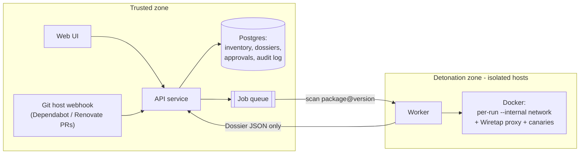

# MalwHunter Service — design draft

Status: **draft, for discussion** · Scope: internal, self-hosted · Last updated: 2026-10-25

## 1. Goal

Run MalwHunter as an internal service that:

1. keeps an **inventory** of every npm `package@version` our projects use, with a stored verdict for each;
2. **gates dependency upgrades**: before a new version lands, the service detonates it in a throwaway sandbox and shows the result;
3. gives people a **UI** to see verdicts and evidence, see *what changed between versions*, and approve or block an upgrade.

Non-goals for v1: ecosystems beyond npm, replacing `npm audit`/SCA tools (MalwHunter is complementary), and full HTTPS content inspection.

## 2. Why this fits MalwHunter

- A Dossier is already keyed by exact `package@version` and is project-independent, so it is **cacheable across every project**. Each version is analyzed once and the result reused.
- The most damaging real npm attacks (event-stream, ua-parser-js, coa/rc) came in as a **new version of an already trusted package**. Upgrade time is exactly where behavioral analysis pays off.
- The CLI already emits a stable JSON report (`--format json`), so the service can wrap the scanner instead of rewriting it.

## 3. Architecture



| Component | Responsibility | Notes |
|---|---|---|
| **Web UI** | Inventory, package detail, version diff, approve/block | Talks only to the API. |
| **API service** | Auth, inventory, cache lookup, enqueue scans, store Dossiers, webhooks | Never runs package code. |
| **Postgres** | Inventory, Dossiers (JSON), approvals, audit log | Dossier table keyed by `ecosystem:name@version` (`Dossier.dossier_key`). |
| **Job queue** | Hands scan jobs to workers | Anything simple: Postgres-backed queue, Redis, or similar. |
| **Detonation worker** | Runs the existing scanner (`fetch → Recon → Detonation → Dossier`) and returns JSON | Runs on **separate, disposable hosts**. |

## 4. Security model (the part that must not be compromised)

Detonation **executes real malware by design**, so the detonation zone is treated as hostile:

1. **Separate hosts.** Workers run on dedicated VMs that are rebuilt regularly and hold no secrets, no SSH keys to other systems, and no route to the internal network. The API/DB never share a host with a worker.
2. **Network.** Each detonation already runs on its own `--internal` Docker network, with the Wiretap proxy as the only reachable endpoint (see `chamber/runner.py`). On top of that, the worker VM's own firewall allows outbound traffic **only** from the proxy, and only to the internet, never to internal ranges.
3. **Worker → API is one-way and narrow.** Workers *pull* jobs and *push* a Dossier JSON with a per-worker token. The API validates the JSON against the schema and treats every field as untrusted text: escape it in the UI, never execute or follow links automatically. Excerpts come straight from attacker-written code.
4. **Fail closed.** A job that errors or times out stores `unscanned`, never `clean`. The upgrade stays blocked until it is rescanned or explicitly approved by a human.
5. **Known blind spot, shown in the UI:** HTTPS traffic is logged by destination only, not contents. Canary detection covers plain HTTP. The UI must say this rather than imply full coverage.

## 5. Core flows

### 5.1 Upgrade check (the main flow)

1. A Dependabot/Renovate PR (or a user in the UI) proposes `axios 1.7.2 → 1.7.4`.
2. The API looks up the Dossier for `npm:axios@1.7.4`.
   - **Cached**, verdict-engine version current → show it immediately.
   - **Missing** → enqueue a scan; the PR gets a pending status check.
3. A worker scans with detonation forced on (`always` mode: for an upgrade gate we want behavior, not the reputation shortcut).
4. The API stores the Dossier, computes the **diff against the previous approved version** (5.3), and posts the result back as a PR status/comment.
5. Policy: `clean` → auto-pass (optional); `suspicious`/`unscanned` → needs a human approval; `malicious` → blocked, approval requires a second person.

### 5.2 Inventory sync

Projects register their repo. On every push to the default branch, the service reads `package-lock.json` (exact versions only; MalwHunter already reports range-only deps as `unscanned`) and updates the inventory. Any `package@version` not yet in the Dossier cache gets queued.

### 5.3 Version diff: the most useful screen

The value for a reviewer is *what this version does that the last approved one didn't*. Computed from two Dossiers:

- new or changed **lifecycle scripts** (`preinstall`/`install`/`postinstall`);
- **new network destinations** seen during detonation;
- **new signal categories** (for example the first appearance of `bulk-env-enumeration`);
- new maintainer or publisher on the registry, and publish age (a version minutes old deserves extra suspicion).

The first three need no new scanner work; they compare existing Dossier fields. Maintainer data needs one extra registry field in intake.

## 6. UI screens (v1)

1. **Inventory**: every `package@version` in use, its verdict, which projects use it, and when it was last scanned. Filters: verdict, project, unscanned.
2. **Package detail**: the Dossier. Verdict banner, each signal with its evidence (file:line + excerpt, network destination), and the detonation decision reason.
3. **Upgrade review**: old vs new version side by side, using the diff from 5.3, with **Approve** / **Block** and a required comment.
4. **Audit log**: who approved or blocked what, when, and against which verdict.

## 7. Data model (sketch)

```
dossiers(key PK, ecosystem, name, version, verdict, report_json, engine_version, scanned_at, worker_id)
projects(id, name, repo_url)
project_dependencies(project_id, dossier_key, first_seen, last_seen)
upgrade_requests(id, project_id, name, from_version, to_version, source, status, created_at)
decisions(id, upgrade_request_id, user, action [approve|block], comment, verdict_at_decision, decided_at)
```

`engine_version` matters: when Recon rules or verdict logic change, older Dossiers can be flagged stale and rescanned in the background.

## 8. Phased plan

| Phase | Deliverable | Depends on |
|---|---|---|
| 0 | Scanner correctness: sandbox isolation, fail-closed `unscanned`, verdict and typosquat fixes | **done locally** (not yet pushed) |
| 1 | API + Postgres + queue + one worker; scan by `package@version` over the API; Dossier cache | Phase 0 |
| 2 | Web UI: inventory, package detail | Phase 1 |
| 3 | Upgrade review + version diff + approve/block + audit log | Phase 2 |
| 4 | Git host integration: webhook on Dependabot/Renovate PRs, status checks | Phase 3 |
| 5 | Hardening: worker VM rebuild cadence, rescans on engine upgrades, metrics | ongoing |

Scanner improvements worth doing alongside: correlate Recon and Detonation evidence (same host in code and in traffic) before calling a package malicious; optional TLS interception in the sandbox so canaries are visible over HTTPS.

## 9. Open questions

1. **How do upgrades reach the service?** Dependabot/Renovate PRs (webhook), manual entry in the UI, a lockfile upload, or all three? This decides whether Phase 4 moves earlier.
2. **Where does it run?** Can we have separate VMs for detonation workers (strongly recommended), or is it one machine for now?
3. **Git host:** GitHub, GitLab, or something else? This decides the webhook and status-check integration.
4. **Auth:** SSO (OIDC/SAML) or local accounts for v1?
5. **Policy:** should `clean` upgrades auto-pass, or does every upgrade need a human click?
6. **Private packages / internal registry:** do we need to scan packages from a private registry? The scanner already reads `MALWHUNTER_NPM_REGISTRY` in your other local copy, but that change isn't in this clone yet.
7. **Tech stack for the API/UI:** staying in Python (FastAPI) keeps it next to the scanner. Any preference for the frontend?
